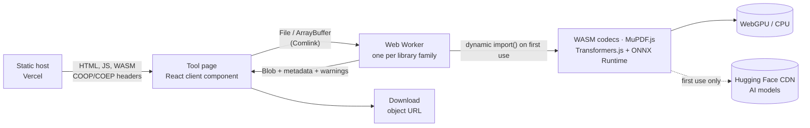

# Architecture

PixelKit is a static website. There is no backend: every tool runs in the visitor's browser, and the host only serves files.

## Overview



- **Build:** Next.js 16 App Router with `output: 'export'` turns every route into an HTML file in `out/`. Server Components run at build time only.
- **Runtime:** client components handle the UI. Anything heavier than reading a file header runs in a **module Web Worker**, so the page never freezes.
- **Lazy loading:** a worker is created the first time a tool needs it, and it imports its library with `import()` on first call. The landing page loads no WASM.
- **Network:** the page fetches only its own files. AI tools also download a model from Hugging Face on first use (cached afterwards). Nothing the user opens is ever sent anywhere.

## Repository layout

```
app/
  layout.tsx  page.tsx  globals.css     # shell, landing, design tokens
  (tools)/<slug>/page.tsx               # one static route per tool (route group, URL is /<slug>)
  about/page.tsx
  lab/                                  # W0 feasibility spike, removed once its numbers are recorded
components/
  ui/          # shadcn/ui and Cult UI components (button, cutout-card, circuit-board)
  originkit/   # Pixel Trail, as delivered by the Originkit CLI (landing hero only)
  site/        # header, footer, logo
  landing/     # landing sections (hero visual, tool card, install button…)
  tool/        # shared tool building blocks (ToolPage, Dropzone, ProgressBar, FileDetails,
               # WarningList, ErrorMessage, DownloadButton, OptionsPanel, BeforeAfter)
  tools/       # one client component per tool (e.g. image-info-tool.tsx)
lib/
  workers/     # client.ts (lazyWorker, progress), errors.ts, index.ts (worker registry), *.worker.ts
  codecs/      # sniff.ts (real format from bytes), dimensions.ts (size from headers)
  site.ts  tools.ts  format.ts  filename.ts  warnings.ts  limits.ts  utils.ts
  lab/         # W0 spike workers
scripts/
  copy-ort-wasm.mjs   # postinstall: ONNX Runtime WASM → public/ort (self-hosted)
  serve-out.mjs       # pnpm preview: serves out/ with the production headers
samples/              # test files for the manual checklist
docs/
```

## Tool flow

Every tool page follows the same skeleton (see [DESIGN.md](DESIGN.md#tool-pages)):

1. `Dropzone` hands a `File` to the tool component.
2. The component calls a method on its worker: `imageWorker.get().inspect(file)`. Comlink sends the `File` to the worker (a `Blob` is passed by reference, not copied).
3. The worker:
   - sniffs the **real format** from the first bytes ([`lib/codecs/sniff.ts`](../lib/codecs/sniff.ts)), never trusting the extension;
   - reads the **dimensions from the header** ([`lib/codecs/dimensions.ts`](../lib/codecs/dimensions.ts)) and refuses images above `MAX_IMAGE_PIXELS` before decoding them;
   - decodes, processes and encodes;
   - reports progress through a `progressCallback` proxy.
4. It returns a `Blob` plus metadata and warning codes, or throws a `ToolError`.
5. The page shows the result, the warnings and a `DownloadButton`, which names the file with `safeFilename()`.

### Worker contract

| | |
|---|---|
| Creation | [`lazyWorker`](../lib/workers/client.ts) in [`lib/workers/index.ts`](../lib/workers/index.ts), with the literal `new Worker(new URL("./x.worker.ts", import.meta.url), { type: "module" })` so Turbopack bundles it |
| Input | `File`/`Blob` (by reference) or `ArrayBuffer` (transferred), plus a plain options object |
| Output | `Blob` + plain metadata object + `WarningCode[]` |
| Progress | `progressCallback(fn)` → `{ fraction: 0–1 \| null, label }` |
| Errors | `throw new ToolError(code)`. The code travels in `error.name` (Comlink keeps it); `describeError()` maps it to a message |
| Cancel | `worker.terminate()` stops the work and frees its memory; the next call starts a fresh worker |

Families: `image` (codecs, resize, ICO, screenshots), `ai` (background removal), `pdf` (MuPDF.js), `vector` (tracing). One worker per family keeps a library crash isolated and lets each one cache its WASM module between calls.

### Warnings and errors

- Warnings ([`lib/warnings.ts`](../lib/warnings.ts)) are the codes from the Python version: `ALPHA_FLATTENED`, `ANIMATION_FIRST_FRAME_ONLY`, `NO_SIZE_REDUCTION`, `UPSCALED`.
- Errors ([`lib/workers/errors.ts`](../lib/workers/errors.ts)) reuse the old API's codes where they still apply (`UNSUPPORTED_FORMAT`, `CORRUPT_FILE`, `IMAGE_TOO_LARGE`, `PDF_ENCRYPTED`…). Each has one plain-language message.

## Cross-origin isolation

Multithreaded WASM (ONNX Runtime, the AVIF encoder) needs `SharedArrayBuffer`, which needs `crossOriginIsolated === true`. A static export can't set headers, so the host does ([`vercel.json`](../vercel.json)):

- `Cross-Origin-Opener-Policy: same-origin`
- `Cross-Origin-Embedder-Policy: credentialless` — lets the page fetch Hugging Face models, which don't send CORP headers

`pnpm dev` doesn't send these headers, so multithreading is off in development. Use `pnpm build && pnpm preview` to test with them.

## Self-hosted runtimes

Transformers.js would download the ONNX Runtime WASM from `cdn.jsdelivr.net`. [`scripts/copy-ort-wasm.mjs`](../scripts/copy-ort-wasm.mjs) runs on `postinstall` and copies it into `public/ort/` (git-ignored); the AI worker points `env.backends.onnx.wasm.wasmPaths` there. Other WASM (jSquash, MuPDF.js, libheif) is bundled by Turbopack from `node_modules`.

## Memory

- Images are refused before decoding when the header says they exceed `MAX_IMAGE_PIXELS` (100 MP for now; device-aware limits come from the W0 measurements).
- Large pixel reads happen in bands.
- `ImageBitmap.close()` after use; object URLs are revoked when a preview changes or a download starts.
- Batches (W10) run one file at a time.

## Offline (W9)

A service worker will cache the app shell and the WASM files already used; Transformers.js keeps models in Cache Storage. After the first visit, tools work without a network.
